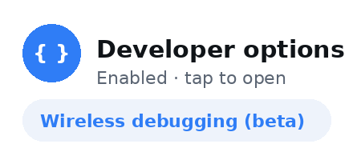

# DevSettings Widget

A personal Expo app whose job is one tap from the Android home screen to **Developer options**. It is built for a Samsung Galaxy S26 Ultra (Android 16 / One UI 8, API 36) and picks the Settings page from a small strategy table, so other phones, Android versions, and a best-effort iOS path can be added as extra rows.

Package id: `com.phuocthinh.devsettings`. Stack: Expo SDK 57, React Native 0.86.3, TypeScript strict. The widget uses [`react-native-android-widget`](https://github.com/sAleksovski/react-native-android-widget). It does **not** run in Expo Go — install the APK.

## Install

**Latest release:** https://github.com/phuocthinh-boonievn/DevSettingsWidget/releases/latest

**Direct APK download:** https://github.com/phuocthinh-boonievn/DevSettingsWidget/releases/latest/download/DevSettingsWidget-universal.apk

That file is a universal release APK (armeabi-v7a, arm64-v8a, x86, and x86_64 in one package, about 95 MB). Native libraries are stored uncompressed, which is why the download is larger than the app's code. The asset name is exactly `DevSettingsWidget-universal.apk`. Both links 404 until the first `v*` release is published. After that, `releases/latest` always points at the newest tag.

The APK is signed with your upload keystore when the repository secrets below are set. Until then the release workflow signs with the **Android debug keystore**, which is enough to install on your own phone. If you later add a real key, Android treats it as a different app: uninstall DevSettings Widget, then install the newly signed APK. Updates only replace an install when the signature matches.

### Install on a Samsung Galaxy (One UI 8 / Android 16)

1. On the phone, open the direct download link in **Chrome** (or copy the APK onto the phone and open it in **My Files**). Chrome may say the file can harm your device — tap **Download anyway**, then **Open** (or **Keep** if Chrome asks).
2. Turn **Auto Blocker** off, or the install is rejected before the unknown-apps prompt appears.
   - **Settings → Security and privacy → Auto Blocker → Off.**
   - Confirm if One UI asks. You can turn it back on after the app is installed.
3. Allow this source to install unknown apps. The system usually jumps here when you tap the APK. If it does not:
   - **Settings → Apps → ⋮ (menu) → Special access → Install unknown apps.**
   - Open **Chrome** if you downloaded in the browser, and **My Files** if you opened the file there.
   - Turn **Allow from this source** on for that app.
4. Tap the APK again and tap **Install**.
5. **Google Play Protect** often warns on a sideloaded app, especially one signed with the debug key. On the scan dialog tap **More details**, then **Install anyway** (wording varies: "Install without scanning" / "Install anyway"). If Play Protect blocks it with no bypass:
   - Open the **Play Store → profile icon → Play Protect → gear icon**.
   - Turn **Scan apps with Play Protect** off, install the APK, then turn scanning back on.
6. Open **DevSettings Widget** once so it can refresh the widget state. You do not need to leave it running.

USB install also works after Developer options and USB debugging are already on: `adb install -r DevSettingsWidget-universal.apk`.

### Add the widget

1. Touch and hold an empty spot on the Home screen.
2. Tap **Widgets**.
3. Search for **DevSettings** (label: "DevSettings Widget").
4. Touch and hold it, then drag it onto the Home screen. Or tap **Add**.
5. Drag a corner to resize. On a widget that is about two rows tall (around 2×2), a **Wireless debugging** row appears on Android 11+ (API 30+). The default size is a short one-row widget with only Developer options.

From inside the app, **Add widget to home screen** asks the launcher to pin it (`requestPinAppWidget`, Android 8+). If the launcher refuses, the app tells you to use the long-press path above.

### What a tap does

The widget does not open the app. An invisible activity reads the plan baked into the widget and starts the first Settings screen that exists. The in-app **Open Developer options** button builds a fresh plan on every press. The widget's plan is from the last time it rendered (when you added it, when you opened the app, or after a tap). Opening the app refreshes placed widgets.

**Samsung, Developer options already on**

1. Public intent `android.settings.APPLICATION_DEVELOPMENT_SETTINGS` — this is the normal success path.
2. Explicit Settings component `com.android.settings/.Settings$DevelopmentSettingsDashboardActivity`, if that intent did not resolve.
3. About phone, if neither Developer options screen exists.
4. The main Settings screen, as a last resort.

**Samsung, Developer options off**

1. One UI **Software information** (`Settings$SoftwareInfoSettingsActivity`, undocumented). A toast says to tap **Build number** 7 times.
2. If that activity is missing, **About phone**, with a toast that points at Software information.
3. The main Settings screen.

After Build number is enabled, open the app once (or tap the widget once so it re-renders) and tap again. The next plan starts at Developer options. The native side also re-reads `Settings.Global.DEVELOPMENT_SETTINGS_ENABLED` at tap time and skips steps that do not match, but it can only skip steps that are already in the plan.

**Developer options state unknown** (native check failed): the full chain is kept, including both the Developer options intents and Software information. The first one that actually starts wins.

**Wireless debugging** (second row, Android 12+ / API 31+, and only while Developer options are on): a community deep link via `QS_TILE_PREFERENCES` to `DevelopmentTiles$WirelessDebugging`. There is no public intent for that page. If the ROM ignores it, the tap falls through to the Developer options chain. The toast says so.

**Nothing on the device handled any step:** a toast, "Could not open Settings on this device."

### Turn on Developer options by hand

On this Galaxy:

1. **Settings → About phone → Software information.**
2. Tap **Build number** seven times.
3. Enter your PIN, password, or pattern when asked.
4. Developer options appears at the bottom of **Settings**.

Then use the widget.

## Screenshots

Launcher preview shipped with the app (this is also the widget picker image):



Phone captures are not in the repo yet. After the first install, add them under `docs/screenshots/` and they will show up here:

| Home screen with the widget | In-app screen | Developer options after a tap |
| --- | --- | --- |
| `docs/screenshots/home.png` | `docs/screenshots/app.png` | `docs/screenshots/dev-options.png` |

## iOS limitations

iOS is best-effort and **not built** in this repo (no Mac / Xcode in CI).

- Apple does not publish a URL for **Settings → Privacy & Security → Developer Mode**. The iOS plan calls `Linking.openSettings()`, which opens this app's own Settings page, and the screen explains the rest. Developer Mode only shows up after the phone has been connected to Xcode or has had a development build installed.
- Private `App-Prefs:` URLs are not used. `IOS_PRIVATE_PREFS_ATTEMPT` in `src/platform/openers.ts` is an optional local-only hack (put it first on the `ios-default` row). It can break on any iOS update and is not acceptable for the App Store.
- `targets/widget/` is a WidgetKit extension scaffold for `@bacons/apple-targets`. Tapping it opens `devsettings:///?open=developerOptions`, and the app runs the iOS plan. Set `ios.appleTeamId` in `app.json`, then on a Mac with Xcode 16: `npx expo prebuild -p ios --clean && npx expo run:ios`.

## Release a new version

The workflow [`.github/workflows/release-apk.yml`](.github/workflows/release-apk.yml) runs on every `v*` tag and from **Actions → Release APK → Run workflow**. It typechecks, runs Jest, prebuilds Android, assembles a universal release APK, and publishes a GitHub Release with `DevSettingsWidget-universal.apk` attached. `permissions: contents: write` is set on that workflow so `GITHUB_TOKEN` can create the release.

1. Bump the version together:
   - `version` in `package.json`
   - `expo.version` in `app.json`
   - `expo.android.versionCode` in `app.json` (integer, must go up for every install that replaces an older one)
2. Merge that commit to `main`.
3. Publish, using either path:
   - **Tag:** on GitHub open **Releases → Draft a new release**, create tag `vX.Y.Z` on `main` (same numbers as `expo.version`), and publish. Pushing the tag starts the workflow. It uploads the APK onto that release.
   - **Manual:** **Actions → Release APK → Run workflow** on `main`. Set the tag input to `vX.Y.Z`, or leave it empty to use `v` plus `package.json`'s `version`. The workflow creates the tag and the release. Creating the tag with `GITHUB_TOKEN` does not start a second run.

Optional signing secrets (repository **Settings → Secrets and variables → Actions**):

| Secret | Value |
| --- | --- |
| `ANDROID_KEYSTORE_BASE64` | `base64 -w 0 your-upload.keystore` |
| `ANDROID_KEYSTORE_PASSWORD` | keystore password |
| `ANDROID_KEY_ALIAS` | key alias |
| `ANDROID_KEY_PASSWORD` | key password |

Set all four, or none. A partial set fails the build instead of quietly falling back. With none set, the APK is debug-signed (see [Install](#install)).

Pull requests run [`.github/workflows/ci.yml`](.github/workflows/ci.yml) (`tsc` and Jest only, no Android SDK).

## Build locally

Node.js 22, JDK 21, and the Android SDK. Packages this project actually compiles against (Expo SDK 57 / React Native 0.86):

- platform `android-36`
- build-tools `36.0.0`
- NDK `27.1.12297006`
- CMake `3.22.1` and `3.30.5`

```bash
npm ci
npx tsc --noEmit
npm test
npx expo prebuild -p android --clean
cd android
./gradlew assembleRelease
```

The universal APK is `android/app/build/outputs/apk/release/app-release.apk`. It is signed with `android/app/debug.keystore` unless you point Gradle at another key (the CI script is `scripts/configure-release-signing.sh`).

An arm64-only APK, which is all the S26 Ultra needs, is the same task with `-PreactNativeArchitectures=arm64-v8a`. Name that file clearly if you share it (`DevSettingsWidget-arm64-v8a.apk`). The GitHub release asset stays the universal file.

A connected phone:

```bash
npx expo run:android
npx expo start --dev-client
```

`android/`, `ios/`, `node_modules/`, `dist/`, and keystores are not committed. `npx expo prebuild` recreates the native projects.

## Project structure

```
app.json                         Expo config, widget plugin, package id
index.ts                         Expo Router entry + Android widget task registration
src/app/                         In-app screen (Expo Router)
src/platform/openers.ts          Strategy table and selectOpeners()
src/platform/types.ts            DeviceContext, attempts, plan
src/platform/execute.ts          runPlan(), widget URI
src/platform/device.ts           expo-device + native module glue
src/widget/                      Home-screen widget UI and task handler
modules/dev-settings-launcher/   Local Expo module (Kotlin opener + trampoline)
targets/widget/                  iOS WidgetKit scaffold (unbuilt)
__tests__/openers.test.ts        Jest: selection, plans, runner
scripts/                         CI signing helper
.github/workflows/ci.yml         PR checks
.github/workflows/release-apk.yml
docs/ARCHITECTURE.md
```

More on how a tap is chosen and executed: [docs/ARCHITECTURE.md](docs/ARCHITECTURE.md).

## Adding a new device / OEM / Android version

Add one object to `OPENER_TABLE` in `src/platform/openers.ts`. Most-specific row wins; existing rows stay as fallbacks. OEM names are matched case-insensitively against `Device.manufacturer` or `Device.brand`.

Example row for OnePlus / OxygenOS (not in the table yet). `com.android.settings` is already allowed. `com.oneplus.` and `com.oplus.` are already in the native allowlist if you later target those packages.

```ts
{
  id: 'android-oneplus',
  description: 'OnePlus / OxygenOS, Android 11+.',
  match: { platform: 'android', oem: ['oneplus'], minApi: 30 },
  targets: {
    developerOptions: [
      DEV_OPTIONS_ACTION,
      {
        kind: 'androidIntent',
        id: 'oneplus.devOptions',
        label: 'Developer options (OnePlus)',
        action: 'android.intent.action.MAIN',
        packageName: 'com.android.settings',
        className: 'com.android.settings.Settings$DevelopmentSettingsDashboardActivity',
        requires: 'devOptionsEnabled',
        bestEffort: true,
      },
      {
        ...DEVICE_INFO,
        id: 'oneplus.deviceInfo',
        hint: 'Developer options are off. Tap "Build number" 7 times, then tap the widget again.',
      },
    ],
  },
},
```

Add a test next to the Samsung cases in `__tests__/openers.test.ts`:

```ts
it('OnePlus API 34 prefers the OnePlus row, then generic fallbacks', () => {
  const plan = selectOpeners(ctx({ manufacturer: 'OnePlus', apiLevel: 34, devOptionsEnabled: true }));
  expect(plan.entryIds[0]).toBe('android-oneplus');
  expect(plan.attempts.map((a) => a.id)).toContain('oneplus.devOptions');
});
```

Then `npm test` and `npx tsc --noEmit`.

**Allowlist:** `AttemptRunner.kt` drops any attempt whose action is outside `ALLOWED_ACTION_PREFIXES` or whose package is outside `ALLOWED_PACKAGE_PREFIXES`. The trampoline is exported, so this is what stops a crafted `devsettingswidget://` URI from launching an arbitrary app. If the new row uses a package that is not already listed (for example a future `com.oneplus.settings` that does not start with `com.oneplus.`), add that prefix in `AttemptRunner.kt` or the widget tap will silently skip the step. Actions must start with one of `android.settings.`, `com.android.settings.`, `android.service.quicksettings.action.`, or `android.intent.action.MAIN`.

A new *target* (something other than Developer options or Wireless debugging) also needs a member on `OpenTarget` in `src/platform/types.ts`. iOS-only changes go on the `ios-default` row (`url` or `appSettings` attempts).

## Development

```bash
npm test            # Jest, 23 tests
npm run typecheck   # tsc --noEmit, strict
npx expo-doctor
```

In-app deep link: `adb shell am start -d "devsettings:///?open=developerOptions"`.

Widget trampoline, using the built-in default plan when `plan` is omitted: `adb shell am start -a android.intent.action.VIEW -d "devsettingswidget://open?target=developerOptions"`.

## License

[MIT](LICENSE).
